# Inventory and Data Management System

Web Dev III, Lab Assignment 3 (Unit 3, CO3)
Rajvardhan Singh, B.Tech CSE, Roll No. 2501010132

REST API for managing a product catalogue. Built with Node.js, Express, MongoDB (Mongoose) and dotenv.

## Run it

```
npm install
npm run seed     # optional, adds 12 sample products
npm start
```

Needs MongoDB running locally, or put an Atlas connection string in `.env` as `MONGO_URI`.

## Endpoints

| Method | URL | What it does |
|--------|-----|--------------|
| POST | /api/products | create a product |
| GET | /api/products | list with filter, sort, pagination |
| GET | /api/products/:id | single product |
| PUT | /api/products/:id | update details |
| PATCH | /api/products/:id/stock | `{ "change": 10 }` restock, `{ "change": -3 }` sale |
| DELETE | /api/products/:id | delete |
| GET | /api/products/low-stock | products at or below reorder level |
| GET | /api/products/summary | category-wise totals (aggregation) |

### Query params for GET /api/products

`category`, `supplier`, `search` (name), `minPrice`, `maxPrice`, `inStock=true|false`,
`sort` (e.g. `-price,name`), `page`, `limit` (default 10, max 100)

Example: `/api/products?category=electronics&minPrice=500&sort=-price&page=1&limit=5`

## Folder structure

```
config/       db connection
models/       Product schema
controllers/  route logic
routes/       url -> controller
middleware/   validation + error handling
```

## Sample output

Responses below are from the running API (seeded with `npm run seed`).

| Endpoint | Screenshot |
|----------|------------|
| GET all products | 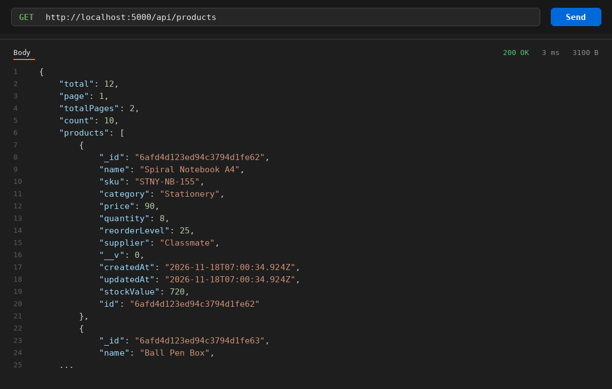 |
| Filter, sort, pagination | 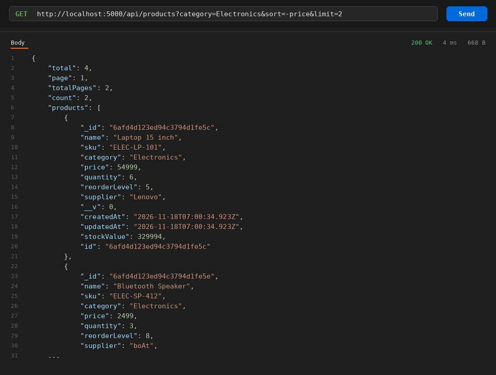 |
| POST create product | 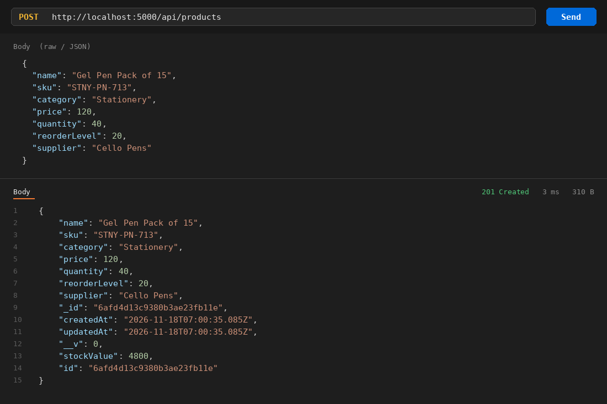 |
| GET product by id | 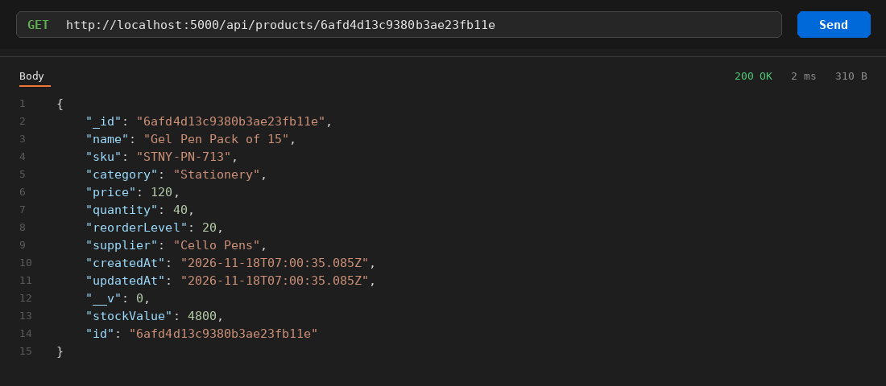 |
| PUT update product | 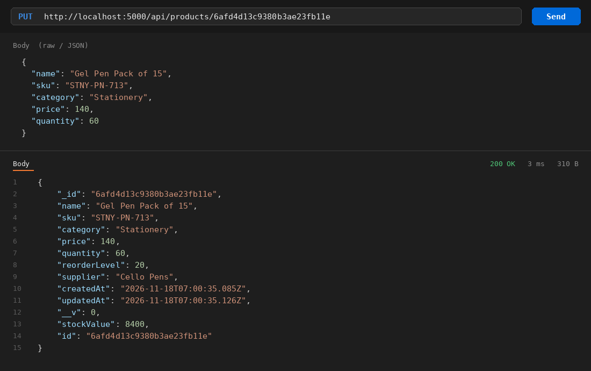 |
| PATCH restock | 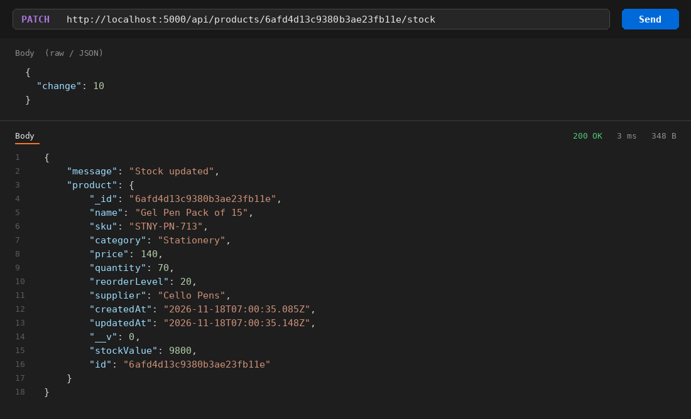 |
| PATCH oversell (400 error) | 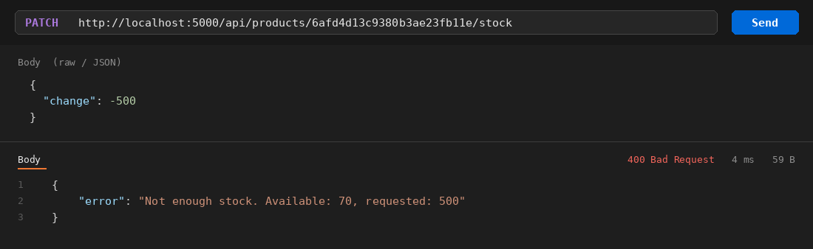 |
| POST validation error | 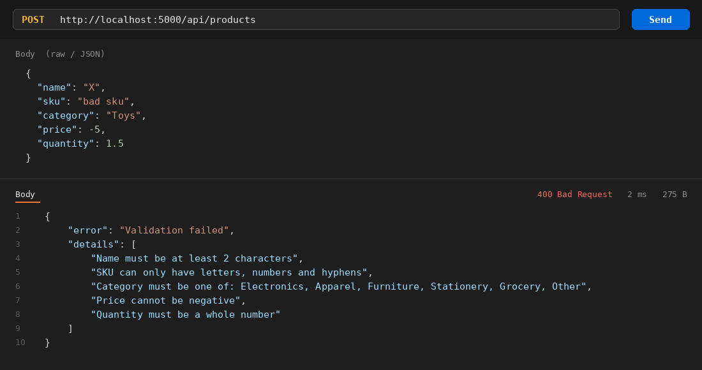 |
| GET low-stock report | 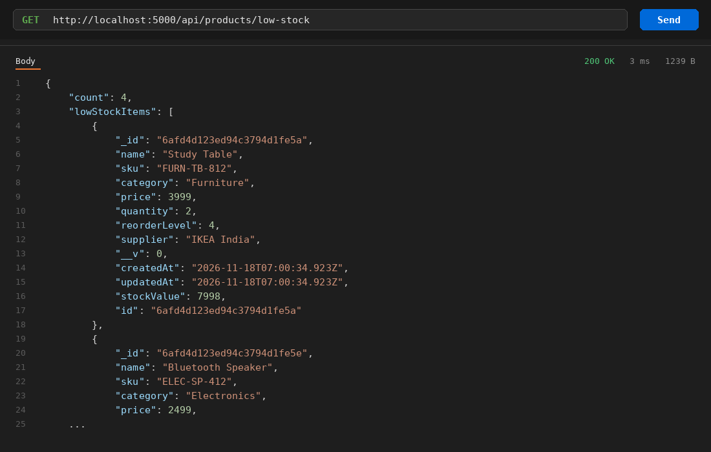 |
| GET category summary | 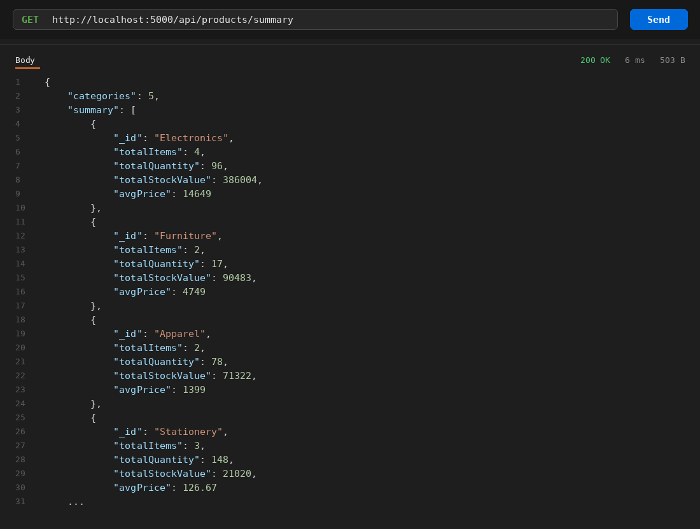 |
| DELETE product | 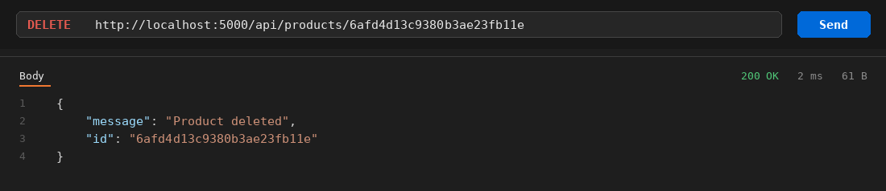 |
